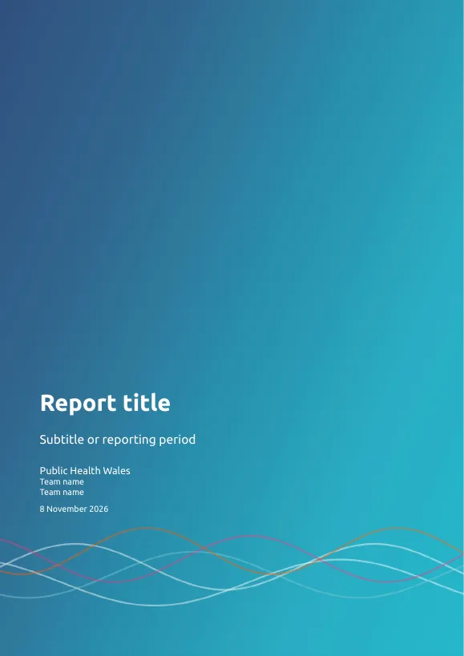

# Reports, slides and dashboards

phwstyle gives whole documents the PHW look: the Ubuntu font, navy
headings, the gradient header band, a cover page for PDFs and slides,
and “Page x of y” footers. This page shows how to render a report, a
slide deck or a dashboard from one document. The examples use made-up
names. You choose a format once in the document’s YAML header, and the
charts and tables inside follow the same style.

There are two routes. Use whichever your team already uses:

|  | R Markdown (`.Rmd`) | Quarto (`.qmd`) |
|----|----|----|
| Formats | HTML, Word, PDF | HTML, Word, PowerPoint, PDF (Typst or LaTeX), slides, dashboards |
| Setup | None: the formats come with phwstyle | Run [`use_phw_quarto()`](https://ch3w3y.github.io/phwstyle-r/reference/use_phw_quarto.md) once in each project |
| Charts and flextables | Styled for you | Call [`use_phw_ggplot()`](https://ch3w3y.github.io/phwstyle-r/reference/use_phw_ggplot.md) and [`use_phw_flextable()`](https://ch3w3y.github.io/phwstyle-r/reference/use_phw_flextable.md) in the setup chunk |
| Needs | The rmarkdown package; LaTeX for PDF | Quarto 1.5 or later (recent versions of RStudio include it) |

[`phw_setup_check()`](https://ch3w3y.github.io/phwstyle-r/reference/phw_setup_check.md)
tells you whether Pandoc, Quarto and LaTeX are available on your
computer.

## R Markdown

Put a phwstyle format in the YAML header, and knit as usual:

``` yaml
---
title: "Report title"
author: "Team name"
output: phwstyle::phw_word_document
---
```

| Format | Output |
|----|----|
| [`phwstyle::phw_html_document`](https://ch3w3y.github.io/phwstyle-r/reference/phw_formats.md) | A web page with the header band, a floating table of contents and the PHW Bootstrap theme. Works offline: the fonts are inside the file |
| [`phwstyle::phw_word_document`](https://ch3w3y.github.io/phwstyle-r/reference/phw_formats.md) | A Word document built from the PHW reference document: Ubuntu, navy headings, tables with horizontal rules only, a header band and a page footer |
| [`phwstyle::phw_pdf_document`](https://ch3w3y.github.io/phwstyle-r/reference/phw_formats.md) | A PDF through LaTeX (XeLaTeX), with a full-page cover, a running header band and a footer |

To start from a working example in RStudio, choose **File \> New File \>
R Markdown \> From Template \> PHW report**. It knits to all three
formats.

The formats call
[`use_phw_ggplot()`](https://ch3w3y.github.io/phwstyle-r/reference/use_phw_ggplot.md)
and
[`use_phw_flextable()`](https://ch3w3y.github.io/phwstyle-r/reference/use_phw_flextable.md)
before knitting, so don’t repeat them in the document. Add
[`theme_phw()`](https://ch3w3y.github.io/phwstyle-r/reference/theme_phw.md)
or a PHW scale to a plot only to change something for that plot.

Options go under the format name. Each format takes the arguments of the
R Markdown format it builds on, and these ones too:

``` yaml
output:
  phwstyle::phw_pdf_document:
    toc: true
    team: "Team name"
    number_sections: false
    fig_width: 7
    palette: accessible
```

- `toc` and `number_sections` add a table of contents and numbered
  headings. The HTML format turns on the table of contents, the PDF
  format turns on numbered headings, and the Word format turns on
  neither.
- `fig_width` and `fig_height` set the default figure size in inches.
- `team` adds a team line to the PDF cover, and `cover: false` drops the
  cover.
- `style_plots: false` stops the format calling
  [`use_phw_ggplot()`](https://ch3w3y.github.io/phwstyle-r/reference/use_phw_ggplot.md)
  and
  [`use_phw_flextable()`](https://ch3w3y.github.io/phwstyle-r/reference/use_phw_flextable.md),
  for a document that styles its own charts.
- `palette` picks the colours for the whole document. See [Default and
  accessible colours](#default-and-accessible-colours).

[`?phw_formats`](https://ch3w3y.github.io/phwstyle-r/reference/phw_formats.md)
lists every option.

To render from R without a YAML header, pass the format object with the
same options:

``` r

rmarkdown::render("report.Rmd", phwstyle::phw_html_document(toc = FALSE))
rmarkdown::render("report.Rmd", phwstyle::phw_pdf_document(team = "Team name"))
```

## Quarto

Run this once in your project folder. It adds the PHW extension in
`_extensions/phw` and writes a starter report:

``` r

phwstyle::use_phw_quarto(template = "report")
```

`template = "slides"` and `template = "dashboard"` write a starter
presentation or dashboard instead, and `template = "none"` adds only the
extension. Run it again with `overwrite = TRUE` after updating phwstyle,
to pick up changes to the extension.

Then name the format in the YAML header:

``` yaml
---
title: "Report title"
format: phw-docx
---
```

| Format | Output |
|----|----|
| `phw-html` | A web page with the header band and a table of contents |
| `phw-docx` | A Word document built from the PHW reference document |
| `phw-pptx` | PowerPoint slides built from the PHW template: 16:9, Ubuntu text and navy titles |
| `phw-typst` | A PDF through Typst, which comes with Quarto, so no LaTeX is needed. Cover page, running header band, page numbers |
| `phw-pdf` | A PDF through LaTeX, for teams that already use it |
| `phw-revealjs` | 16:9 HTML slides with a title slide, logo and footer |
| `phw-dashboard` | A one-page dashboard with a navy navigation bar and PHW cards |

A Quarto extension styles the page but can’t run R code, so style the
charts and tables in the setup chunk, as the starter documents do:

```` markdown

``` r
library(ggplot2)
library(phwstyle)
use_phw_ggplot()
use_phw_flextable()
```
````

The Typst PDF takes a few extra options in the YAML header:
`phw-team: "Team name"` adds a team line to the cover,
`phw-no-cover: true` drops the cover, and `phw-org`, `phw-page-label`
and `phw-of-label` change the footer wording. See
[`?use_phw_quarto`](https://ch3w3y.github.io/phwstyle-r/reference/use_phw_quarto.md).

Quarto builds a `phw-pptx` deck from your headings and content. To fill
a deck from R, with a slide for each chart or table, see [Excel,
PowerPoint and
Word](https://ch3w3y.github.io/phwstyle-r/articles/exporting.html#powerpoint).

To make several formats from one document, list them:

``` yaml
format:
  phw-html: default
  phw-docx: default
  phw-typst: default
```



The
[gallery](https://ch3w3y.github.io/phwstyle-r/articles/gallery.html#documents)
shows every format, including the slides and dashboard.

## Default and accessible colours

Some readers need colours that stay distinct for every type of colour
blindness. The `accessible` palette does that, and switching it on for a
document changes every chart, table and widget made with phwstyle (see
[Colours and
accessibility](https://ch3w3y.github.io/phwstyle-r/articles/colours.html#colour-blind-safe-colours)).

**To switch a document for good**, add one line to its YAML header. It
works the same in R Markdown and Quarto:

``` yaml
phw-palette: accessible
```

**To make both versions from one unchanged document**, set the palette
when you render. In R Markdown, use `output_options`:

``` r

word <- "phwstyle::phw_word_document"
rmarkdown::render("report.Rmd", word, output_file = "report.docx")
rmarkdown::render("report.Rmd", word, output_file = "report-accessible.docx",
                  output_options = list(palette = "accessible"))
```

In Quarto, set the environment variable `PHWSTYLE_PALETTE` for the
second render. From R (this works on Windows too):

``` r

system2("quarto", c("render", "report.qmd", "--to", "phw-docx"))

Sys.setenv(PHWSTYLE_PALETTE = "accessible")
system2("quarto", c("render", "report.qmd", "--to", "phw-docx",
                    "-o", "report-accessible.docx"))
Sys.unsetenv("PHWSTYLE_PALETTE")
```

Or from a terminal:

``` sh
quarto render report.qmd --to phw-docx
PHWSTYLE_PALETTE=accessible quarto render report.qmd --to phw-docx -o report-accessible.docx
```

In PowerShell, set it with `$env:PHWSTYLE_PALETTE = "accessible"` before
the second render, and clear it with `Remove-Item Env:PHWSTYLE_PALETTE`
afterwards.

The setting has to reach R through the document or the environment:
Quarto doesn’t pass `-M` values or `_quarto.yml` settings on to R.

If you keep colour keys in a file
([`phw_key_file()`](https://ch3w3y.github.io/phwstyle-r/reference/phw_key.md)
in the setup chunk), each group keeps its colour in both versions, from
one run to the next.

## The files behind the formats

Three functions write the files the formats are built from. Use them to
look at what a format does, or to brand a tool that phwstyle has no
format for. Each takes a `file` path and returns it.

- [`phw_reference_docx()`](https://ch3w3y.github.io/phwstyle-r/reference/phw_reference_docx.md)
  writes the Word document behind
  [`phw_word_document()`](https://ch3w3y.github.io/phwstyle-r/reference/phw_formats.md)
  and `phw-docx`. Open it in Word to see its styles, or pass it to
  Quarto as `reference-doc` or to
  [`officer::read_docx()`](https://davidgohel.github.io/officer/reference/read_docx.html).
- [`phw_reference_pptx()`](https://ch3w3y.github.io/phwstyle-r/reference/phw_reference_pptx.md)
  writes the PowerPoint template behind
  [`phw_pptx()`](https://ch3w3y.github.io/phwstyle-r/reference/phw_pptx.md)
  and `phw-pptx`. It has one slide master called `"PHW"` and the layouts
  that [Excel, PowerPoint and
  Word](https://ch3w3y.github.io/phwstyle-r/articles/exporting.html#layouts)
  describes.
- [`phw_latex_header()`](https://ch3w3y.github.io/phwstyle-r/reference/phw_latex_header.md)
  writes the LaTeX header behind
  [`phw_pdf_document()`](https://ch3w3y.github.io/phwstyle-r/reference/phw_formats.md),
  with the font and logo paths filled in. `team` adds the cover line and
  `cover = FALSE` drops the cover. Use it for another LaTeX format, such
  as bookdown.

``` r

library(phwstyle)
files <- c(docx = phw_reference_docx(),
           pptx = phw_reference_pptx(),
           tex = phw_latex_header(team = "Team name"))
file.exists(files)
#> [1] TRUE TRUE TRUE
```

Give each function a `file` to keep the copy, and name it in your
document:

``` yaml
format:
  docx:
    reference-doc: phw-reference.docx
  pdf:
    include-in-header: phw-header.tex
```

## Fonts and the logo

HTML pages, slides and dashboards embed Ubuntu, and the PDF formats use
the copy inside phwstyle. Word and PowerPoint files name Ubuntu without
embedding it, so they show it only on computers that have it. See
[Installation and
setup](https://ch3w3y.github.io/phwstyle-r/articles/setup.html#fonts)
for installing the fonts, and [the logos
section](https://ch3w3y.github.io/phwstyle-r/articles/setup.html#logos)
for adding the PHW logo. After adding the logo, run
`use_phw_quarto(overwrite = TRUE)` so the Quarto extension picks it up.

## Shiny apps

Apps have their own page. See [Interactive charts, tables and
apps](https://ch3w3y.github.io/phwstyle-r/articles/interactive.html#shiny-and-bslib)
for
[`phw_page_navbar()`](https://ch3w3y.github.io/phwstyle-r/reference/phw_page_navbar.md),
[`phw_bs_theme()`](https://ch3w3y.github.io/phwstyle-r/reference/phw_bs_theme.md)
and the example app.
