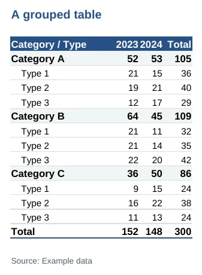

# Excel, PowerPoint and Word

This page shows how to turn the tables and charts you already have into
an Excel workbook, a PowerPoint deck and a Word file. For interactive
tables, see [Interactive charts, tables and
apps](https://ch3w3y.github.io/phwstyle-r/articles/interactive.md). The
data below is made up.

``` r

library(phwstyle)
library(dplyr)
library(ggplot2)
use_phw_ggplot()
set.seed(1)
dat <- tibble(group = sample(c("Group A", "Group B", "Group C"), 300, replace = TRUE),
              type = sample(c("Type 1", "Type 2", "Type 3"), 300, replace = TRUE),
              year = sample(2024:2025, 300, replace = TRUE))
tab <- phw_group_table(dat, c(group, type), year)
bars <- ggplot(dat, aes(group, fill = type)) + geom_bar() +
  scale_fill_phw_d() + labs(x = NULL, y = "Cases", fill = NULL)
```

## Excel

[`phw_write_xlsx()`](https://ch3w3y.github.io/phwstyle-r/reference/phw_write_xlsx.md)
writes one sheet per table, with a title, a navy header, number formats,
frozen headers and the source underneath. Summary tables keep their bold
group rows and indents.

``` r

phw_write_xlsx(list(Grouped = tab, Raw = dat), "tables.xlsx",
               title = c("Counts by group and type", "Raw data"), source = "Example data")
```



An Excel sheet with a grouped table

## PowerPoint

[`phw_pptx()`](https://ch3w3y.github.io/phwstyle-r/reference/phw_pptx.md)
starts a deck from the PHW template. It is 16:9, with Ubuntu text, navy
titles and a navy bar across the top of each content slide.
[`phw_add_slide()`](https://ch3w3y.github.io/phwstyle-r/reference/phw_pptx.md)
adds one slide at a time, and each slide holds a title and one chart,
one table or one set of bullet points. Add `source` and `date` for the
caption at the bottom. Save the deck with
[`print()`](https://rdrr.io/r/base/print.html).

``` r

deck <- phw_pptx() |>
  phw_add_slide("Weekly summary", text = "Team name, example data",
                layout = "Title Slide") |>
  phw_add_slide("Key messages",
                text = c("First message", "Second message", "Third message")) |>
  phw_add_slide("Cases by group and type", plot = bars,
                source = "Example data", date = "2025-06-30") |>
  phw_add_slide("Grouped table", table = tab, source = "Example data") |>
  phw_add_slide("Next steps", layout = "Section Header")
print(deck, target = "slides.pptx")
```


Slides from the PHW template: a title slide, bullet points and a chart

### Layouts

`layout` picks a slide layout from the template. The default is
`"Title and Content"`. The PHW template also has these:

- `"Title Slide"` shows the title on a navy background, with `text` as
  the subtitle.
- `"Section Header"` shows the title on navy, for the start of a
  section.
- `"Title Only"` and `"Blank"` leave room for your own content.
- `"Two Content"` has two body areas, and
  [`phw_add_slide()`](https://ch3w3y.github.io/phwstyle-r/reference/phw_pptx.md)
  fills the first.

### Charts and tables

Each argument below has a default that suits most slides. Change one
only when a slide needs it.

- `plot_scale` enlarges the text of a chart on the slide, as a multiple
  of its size. The default `1.5` brings axis and legend text to about 14
  points, and `1` leaves the chart as it is.
- `table_fit` enlarges a table built here from a data frame or summary
  table, by up to 1.6 times for the text, so it reads on a slide.
  `FALSE` keeps the size
  [`phw_flextable()`](https://ch3w3y.github.io/phwstyle-r/reference/phw_flextable.md)
  gives it. A flextable you pass in is never resized.
- `editable` adds a chart as an editable vector graphic when the rvg
  package is installed, so colleagues can change it in PowerPoint.
  `editable = FALSE` adds a picture instead.
- `alt` gives a chart or table alternative text for screen readers.
  Without it, a ggplot uses the text from `labs(alt = )`.
- `caption_args` takes a list of
  [`phw_caption()`](https://ch3w3y.github.io/phwstyle-r/reference/phw_caption.md)
  arguments other than `source` and `date`, such as `source_prefix`.

``` r

deck <- phw_pptx() |>
  phw_add_slide("Cases by group and type", plot = bars,
                alt = "Stacked bars of cases in groups A, B and C, split by type.",
                source = "Example data", caption_args = list(source_prefix = "Data: "),
                plot_scale = 1.5, editable = FALSE)
```

`title_size` sets the title size, which is 28 points by default. The
title and section slides set their own size, so `title_size` applies
there only when you give it.

### Your own template

Pass a PowerPoint file to
[`phw_pptx()`](https://ch3w3y.github.io/phwstyle-r/reference/phw_pptx.md)
to use its layouts instead. Name the layouts it has in `layout`, and
`master` too, if two slide masters share a layout name.
[`officer::layout_summary()`](https://davidgohel.github.io/officer/reference/layout_summary.html)
lists them.

The template names Ubuntu without embedding it, so PowerPoint shows it
only on computers that have the font. See [Installation and
setup](https://ch3w3y.github.io/phwstyle-r/articles/setup.html#fonts).

[`phw_reference_pptx()`](https://ch3w3y.github.io/phwstyle-r/reference/phw_reference_pptx.md)
writes the PHW template to a file. Open it in PowerPoint to see the
layouts or to start your own template from it.

``` r

phw_reference_pptx("phw-template.pptx")
deck <- phw_pptx("phw-template.pptx")
officer::layout_summary(deck)
```

The gallery shows
[slides](https://ch3w3y.github.io/phwstyle-r/articles/gallery.html#presenting)
and [Office
files](https://ch3w3y.github.io/phwstyle-r/articles/gallery.html#office).

## Word

Any
[`phw_flextable()`](https://ch3w3y.github.io/phwstyle-r/reference/phw_flextable.md)
can be saved to Word, several to one file:

``` r

flextable::save_as_docx(`Table 1` = phw_flextable(tab), path = "tables.docx")
```

See
[Tables](https://ch3w3y.github.io/phwstyle-r/articles/tables.html#render-the-same-table-anywhere)
for the other table renderers. For whole reports, use
`output: phwstyle::phw_word_document` in R Markdown or
`format: phw-docx` in Quarto, as [Reports, slides and
dashboards](https://ch3w3y.github.io/phwstyle-r/articles/documents.md)
explains.
