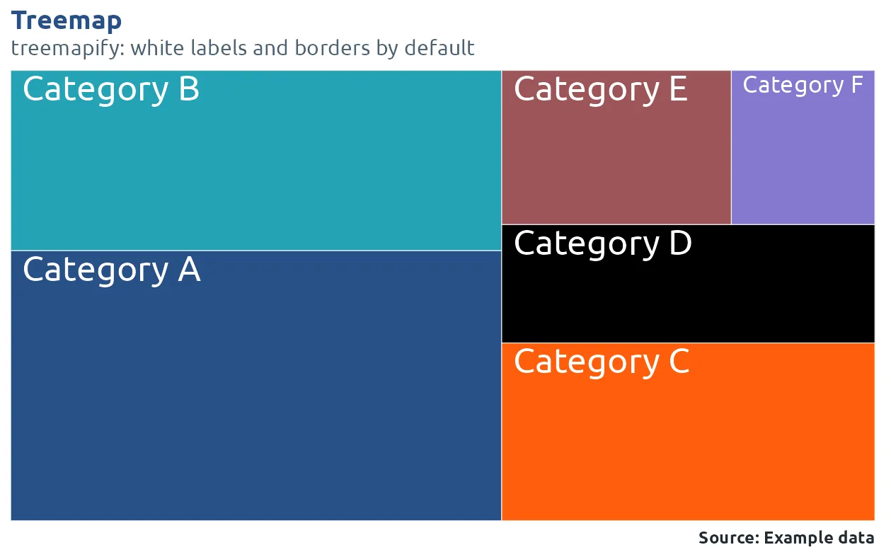
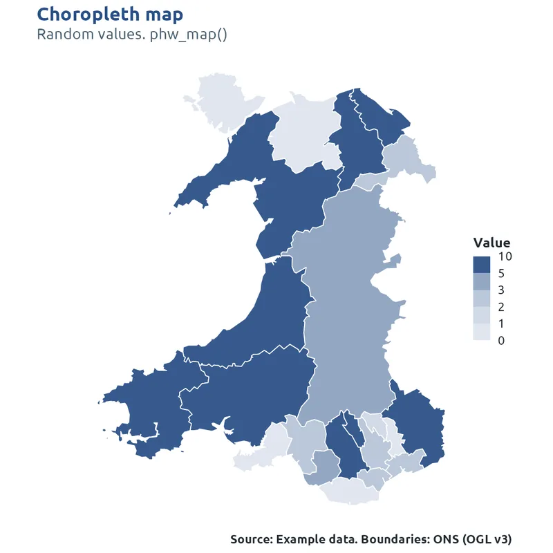

# Gallery

All examples use made-up data. Code:
[`gallery/build-gallery.R`](https://github.com/Ch3w3y/phwstyle-r/blob/main/gallery/build-gallery.R).
Commented walk-through:
[`examples/phwstyle-demo.R`](https://github.com/Ch3w3y/phwstyle-r/blob/main/examples/phwstyle-demo.R).

[1Everyday charts](#charts)[2Uncertainty and
distributions](#uncertainty)[3Public health
charts](#public-health)[4Extension packages](#extensions)[5Layout and
finishing](#finishing)[6Colour and
accessibility](#colour)[7Maps](#maps)[8Tables for
reports](#tables)[9Interactive tables and
charts](#interactive)[10Reports and documents](#documents)[11Slides,
dashboards and apps](#presenting)[12Office files](#office)

Show:

All

Static chart

Static map

Report table

Interactive (HTML)

Document template

Office file

1

## Everyday charts

11 of 11 examples

Standard ggplot2 charts. Call
[`use_phw_ggplot()`](https://ch3w3y.github.io/phwstyle-r/reference/use_phw_ggplot.md)
once at the top of a script and every chart after it gets the PHW theme,
font and colours. The scale functions pick colours from PHW palettes.

Static chart

#### Lines with shapes

Several groups over time. Shapes give a second cue for readers who can't
tell the colours apart, and the colour key keeps each group's colour the
same in every chart.

phwstyle[`use_phw_ggplot()`](https://ch3w3y.github.io/phwstyle-r/reference/use_phw_ggplot.md)
[`scale_colour_phw_d()`](https://ch3w3y.github.io/phwstyle-r/reference/phw_scales.md)
[`scale_shape_phw()`](https://ch3w3y.github.io/phwstyle-r/reference/scale_shape_phw.md)

Key arguments`key = "gallery_groups"`

Packages[ggplot2](https://cran.r-project.org/package=ggplot2)

Shows inRStudio Plots pane, saved as PNG, SVG or PDF, and in every
report format

Static chart

#### Horizontal bars with labels

Ranked values for named areas. Horizontal bars leave room for long
names, and only vertical gridlines are drawn.

phwstyle[`theme_phw()`](https://ch3w3y.github.io/phwstyle-r/reference/theme_phw.md)
[`phw_col()`](https://ch3w3y.github.io/phwstyle-r/reference/phw_col.md)

Key arguments`theme_phw(grid = "x")`

Packages[ggplot2](https://cran.r-project.org/package=ggplot2)

Shows inRStudio Plots pane, saved as PNG, SVG or PDF, and in every
report format

Static chart

#### Grouped columns in a grid

Two series side by side, split into panels with
[`facet_grid()`](https://ggplot2.tidyverse.org/reference/facet_grid.html),
with a dashed target line and navy panel strips.

phwstyle[`theme_phw()`](https://ch3w3y.github.io/phwstyle-r/reference/theme_phw.md)
[`phw_percent()`](https://ch3w3y.github.io/phwstyle-r/reference/phw_number.md)

Key arguments`theme_phw(strip = "navy")`

Packages[ggplot2](https://cran.r-project.org/package=ggplot2)

Shows inRStudio Plots pane, saved as PNG, SVG or PDF, and in every
report format

Static chart

#### 100% stacked bars

Shares of a whole by year. A level called "Unknown" (or "Missing", "Not
known") is drawn grey automatically.

phwstyle[`scale_fill_phw_d()`](https://ch3w3y.github.io/phwstyle-r/reference/phw_scales.md)
[`phw_percent()`](https://ch3w3y.github.io/phwstyle-r/reference/phw_number.md)

Packages[ggplot2](https://cran.r-project.org/package=ggplot2)

Shows inRStudio Plots pane, saved as PNG, SVG or PDF, and in every
report format

Static chart

#### Stacked area

Counts by group over time. Uses the same colour key as the line chart,
so Group 1 is the same colour in both.

phwstyle[`scale_fill_phw_d()`](https://ch3w3y.github.io/phwstyle-r/reference/phw_scales.md)

Key arguments`key = "gallery_groups"`

Packages[ggplot2](https://cran.r-project.org/package=ggplot2)

Shows inRStudio Plots pane, saved as PNG, SVG or PDF, and in every
report format

Static chart

#### Bars with a rolling average

Daily counts as bars with a 7-day average line on top, each with its own
legend entry.

phwstyle[`phw_epicurve()`](https://ch3w3y.github.io/phwstyle-r/reference/phw_epicurve.md)

Key arguments`average = 7`

Packages[ggplot2](https://cran.r-project.org/package=ggplot2)

Shows inRStudio Plots pane, saved as PNG, SVG or PDF, and in every
report format

Static chart

#### Scatter with a continuous colour

Two measures against each other, with a fitted line and a third measure
as colour.

phwstyle[`scale_colour_phw_c()`](https://ch3w3y.github.io/phwstyle-r/reference/phw_scales.md)

Packages[ggplot2](https://cran.r-project.org/package=ggplot2)

Shows inRStudio Plots pane, saved as PNG, SVG or PDF, and in every
report format

Static chart

#### Small multiples

One small panel per area with
[`facet_wrap()`](https://ggplot2.tidyverse.org/reference/facet_wrap.html).
The theme styles the panel strips.

phwstyle[`theme_phw()`](https://ch3w3y.github.io/phwstyle-r/reference/theme_phw.md)
[`phw_col()`](https://ch3w3y.github.io/phwstyle-r/reference/phw_col.md)

Packages[ggplot2](https://cran.r-project.org/package=ggplot2)

Shows inRStudio Plots pane, saved as PNG, SVG or PDF, and in every
report format

Static chart

#### Diverging heat map

Change above and below zero. Cell labels switch between dark and white
text to stay readable on every fill.

phwstyle[`scale_fill_phw_div()`](https://ch3w3y.github.io/phwstyle-r/reference/phw_scales.md)
[`phw_text_on()`](https://ch3w3y.github.io/phwstyle-r/reference/phw_text_on.md)

Key arguments`midpoint = 0`

Packages[ggplot2](https://cran.r-project.org/package=ggplot2)

Shows inRStudio Plots pane, saved as PNG, SVG or PDF, and in every
report format

Static chart

#### Observed and projected

Solid and dashed lines from the linetype scale, so the chart still reads
when printed in black and white.

phwstyle[`scale_linetype_phw()`](https://ch3w3y.github.io/phwstyle-r/reference/scale_shape_phw.md)
[`scale_colour_phw_d()`](https://ch3w3y.github.io/phwstyle-r/reference/phw_scales.md)

Packages[ggplot2](https://cran.r-project.org/package=ggplot2)

Shows inRStudio Plots pane, saved as PNG, SVG or PDF, and in every
report format

Static chart

#### Change between two periods

A dumbbell chart: one row per area, a dot per period and a line between
them.

phwstyle[`scale_colour_phw_d()`](https://ch3w3y.github.io/phwstyle-r/reference/phw_scales.md)
[`theme_phw()`](https://ch3w3y.github.io/phwstyle-r/reference/theme_phw.md)

Packages[ggplot2](https://cran.r-project.org/package=ggplot2)

Shows inRStudio Plots pane, saved as PNG, SVG or PDF, and in every
report format

[Back to top](#top)

2

## Uncertainty and distributions

5 of 5 examples

Intervals you have already calculated, and the spread of values.

Static chart

#### Rate with a confidence band

A monthly rate per 100,000 with limits you supply drawn as a shaded
band, using
[`geom_ribbon()`](https://ggplot2.tidyverse.org/reference/geom_ribbon.html).

phwstyle[`phw_col()`](https://ch3w3y.github.io/phwstyle-r/reference/phw_col.md)

Packages[ggplot2](https://cran.r-project.org/package=ggplot2)

Shows inRStudio Plots pane, saved as PNG, SVG or PDF, and in every
report format

Static chart

#### Rates by area with intervals

A forest plot of estimates and intervals you have already calculated:
each area's rate and interval against a target line, coloured by whether
it is higher, similar or lower.

phwstyle[`phw_forest()`](https://ch3w3y.github.io/phwstyle-r/reference/phw_forest.md)

Key arguments`target = overall`

Packages[ggplot2](https://cran.r-project.org/package=ggplot2)

Shows inRStudio Plots pane, saved as PNG, SVG or PDF, and in every
report format

Static chart

#### Highlight one group

Box plots with one group picked out and the rest in grey.

phwstyle[`scale_fill_phw_d()`](https://ch3w3y.github.io/phwstyle-r/reference/phw_scales.md)

Key arguments`palette = "highlight"`

Packages[ggplot2](https://cran.r-project.org/package=ggplot2)

Shows inRStudio Plots pane, saved as PNG, SVG or PDF, and in every
report format

Static chart

#### Histograms by group

The distribution of a measure in each group, one panel per group.

phwstyle[`scale_fill_phw_d()`](https://ch3w3y.github.io/phwstyle-r/reference/phw_scales.md)

Packages[ggplot2](https://cran.r-project.org/package=ggplot2)

Shows inRStudio Plots pane, saved as PNG, SVG or PDF, and in every
report format

Static chart

#### Ridgeline plot

Distributions stacked as ridges. ggridges picks up the PHW styling
automatically.

phwstyle[`scale_fill_phw_d()`](https://ch3w3y.github.io/phwstyle-r/reference/phw_scales.md)
[`phw_style_extensions()`](https://ch3w3y.github.io/phwstyle-r/reference/phw_style_extensions.md)

Packages[ggplot2](https://cran.r-project.org/package=ggplot2)
[ggridges](https://cran.r-project.org/package=ggridges)

Shows inRStudio Plots pane, saved as PNG, SVG or PDF, and in every
report format

[Back to top](#top)

3

## Public health charts

4 of 4 examples

Ready-made charts for common surveillance and quality outputs. Each
returns a ggplot, so you can add titles, scales or layers as usual.

Static chart

#### Epidemic curve

Cases by week of onset from a line list, stacked by group. Days, weeks
or months.

phwstyle[`phw_epicurve()`](https://ch3w3y.github.io/phwstyle-r/reference/phw_epicurve.md)

Key arguments`interval = "week"`

Packages[ggplot2](https://cran.r-project.org/package=ggplot2)

Shows inRStudio Plots pane, saved as PNG, SVG or PDF, and in every
report format

Static chart

#### Population pyramid

Age and sex structure as percentages, with outlines for a comparison
population.

phwstyle[`phw_pyramid()`](https://ch3w3y.github.io/phwstyle-r/reference/phw_pyramid.md)

Key arguments`compare = other_pop`

Packages[ggplot2](https://cran.r-project.org/package=ggplot2)

Shows inRStudio Plots pane, saved as PNG, SVG or PDF, and in every
report format

Static chart

#### Funnel plot

Proportions by unit against size, with 95% and 99.8% control limits.
Units outside the limits are labelled.

phwstyle[`phw_funnel()`](https://ch3w3y.github.io/phwstyle-r/reference/phw_funnel.md)

Packages[ggplot2](https://cran.r-project.org/package=ggplot2)

Shows inRStudio Plots pane, saved as PNG, SVG or PDF, and in every
report format

Static chart

#### SPC chart

A control chart (XmR: individual values, with limits from the moving
range) with limits from a baseline period. Shifts, trends and points
outside the limits are flagged.

phwstyle[`phw_spc()`](https://ch3w3y.github.io/phwstyle-r/reference/phw_spc.md)

Key arguments`improvement = "increase", baseline = 20`

Packages[ggplot2](https://cran.r-project.org/package=ggplot2)

Shows inRStudio Plots pane, saved as PNG, SVG or PDF, and in every
report format

[Back to top](#top)

4

## Extension packages

3 of 3 examples

ggplot2 extension packages are styled too. Load them before
[`use_phw_ggplot()`](https://ch3w3y.github.io/phwstyle-r/reference/use_phw_ggplot.md),
or call
[`phw_style_extensions()`](https://ch3w3y.github.io/phwstyle-r/reference/phw_style_extensions.md)
after loading them.

Static chart

#### Flow diagram with three stages

A Sankey-style flow through three stages. Add more stages with axis4,
axis5 and so on.

phwstyle[`phw_style_extensions()`](https://ch3w3y.github.io/phwstyle-r/reference/phw_style_extensions.md)
[`scale_fill_phw_d()`](https://ch3w3y.github.io/phwstyle-r/reference/phw_scales.md)

Packages[ggplot2](https://cran.r-project.org/package=ggplot2)
[ggalluvial](https://cran.r-project.org/package=ggalluvial)

Shows inRStudio Plots pane, saved as PNG, SVG or PDF, and in every
report format

Static chart

#### Treemap

Parts of a whole as rectangles, with white labels and borders.

phwstyle[`phw_style_extensions()`](https://ch3w3y.github.io/phwstyle-r/reference/phw_style_extensions.md)
[`scale_fill_phw_d()`](https://ch3w3y.github.io/phwstyle-r/reference/phw_scales.md)

Packages[ggplot2](https://cran.r-project.org/package=ggplot2)
[treemapify](https://cran.r-project.org/package=treemapify)

Shows inRStudio Plots pane, saved as PNG, SVG or PDF, and in every
report format

Static chart

#### Labels that avoid each other

Point labels pushed apart so they don't overlap, in the PHW font.

phwstyle[`phw_style_extensions()`](https://ch3w3y.github.io/phwstyle-r/reference/phw_style_extensions.md)

Packages[ggplot2](https://cran.r-project.org/package=ggplot2)
[ggrepel](https://cran.r-project.org/package=ggrepel)

Shows inRStudio Plots pane, saved as PNG, SVG or PDF, and in every
report format

[Back to top](#top)

5

## Layout and finishing

3 of 3 examples

Put several charts in one figure, add the source and date bar, and save
at the right size.

Static chart

#### Source and date bar

A footer with the source, team and date (and the logo, if you have
downloaded it), then saved at report size.

phwstyle[`phw_finalise()`](https://ch3w3y.github.io/phwstyle-r/reference/phw_finalise.md)
[`phw_save()`](https://ch3w3y.github.io/phwstyle-r/reference/phw_save.md)

Packages[ggplot2](https://cran.r-project.org/package=ggplot2)

Shows inRStudio Plots pane, saved as PNG, SVG or PDF, and in every
report format

Static chart

#### Several charts in one figure

Panels side by side with a shared title, panel letters and source line.

phwstyle[`phw_arrange()`](https://ch3w3y.github.io/phwstyle-r/reference/phw_arrange.md)

Key arguments`tag_levels = "A"`

Packages[ggplot2](https://cran.r-project.org/package=ggplot2)
[patchwork](https://cran.r-project.org/package=patchwork)

Shows inRStudio Plots pane, saved as PNG, SVG or PDF, and in every
report format

Static chart

#### gridExtra layout

The same with gridExtra, using a PHW title block.

phwstyle[`phw_title_grob()`](https://ch3w3y.github.io/phwstyle-r/reference/phw_title_grob.md)
[`phw_finalise()`](https://ch3w3y.github.io/phwstyle-r/reference/phw_finalise.md)

Packages[ggplot2](https://cran.r-project.org/package=ggplot2)
[gridExtra](https://cran.r-project.org/package=gridExtra)

Shows inRStudio Plots pane, saved as PNG, SVG or PDF, and in every
report format

[Back to top](#top)

6

## Colour and accessibility

4 of 4 examples

Palettes, colour keys that keep each group's colour across reports, and
checks for colour blindness and contrast.

Static chart

#### All palettes

Every PHW palette with its name, for use as `palette = "..."` in any
function: groups (`main`, `extended`, `accessible`, `strategy`), status
(`rag`) and numbers (`blues`, `greens` and more).

phwstyle[`show_phw_palettes()`](https://ch3w3y.github.io/phwstyle-r/reference/show_phw_palettes.md)

Packages[ggplot2](https://cran.r-project.org/package=ggplot2)

Shows inRStudio Plots pane, saved as PNG, SVG or PDF, and in every
report format

Static chart

#### Palettes with colour blindness

The same palettes as seen with deuteranopia, the most common type.

phwstyle[`show_phw_palettes()`](https://ch3w3y.github.io/phwstyle-r/reference/show_phw_palettes.md)
[`phw_cvd()`](https://ch3w3y.github.io/phwstyle-r/reference/phw_cvd.md)

Key arguments`cvd = "deutan"`

Packages[ggplot2](https://cran.r-project.org/package=ggplot2)

Shows inRStudio Plots pane, saved as PNG, SVG or PDF, and in every
report format

Static chart

#### Colour-blind safe palette

Seven groups in the palette that stays distinct for the common types of
colour blindness.

phwstyle[`scale_colour_phw_d()`](https://ch3w3y.github.io/phwstyle-r/reference/phw_scales.md)

Key arguments`palette = "accessible"`

Packages[ggplot2](https://cran.r-project.org/package=ggplot2)

Shows inRStudio Plots pane, saved as PNG, SVG or PDF, and in every
report format

Static chart

#### Colours that stay with their groups

Report 2 adds a group and "Unknown", and the existing groups keep their
colours from report 1.

phwstyle[`phw_colour_key()`](https://ch3w3y.github.io/phwstyle-r/reference/phw_colour_key.md)
[`scale_fill_phw_d()`](https://ch3w3y.github.io/phwstyle-r/reference/phw_scales.md)

Key arguments`key = "my_groups"`

Packages[ggplot2](https://cran.r-project.org/package=ggplot2)

Shows inRStudio Plots pane, saved as PNG, SVG or PDF, and in every
report format

[Back to top](#top)

7

## Maps

7 of 7 examples

Boundaries for every level of Welsh geography are downloaded on first
use and cached. Static maps use ggplot2 and sf, and interactive maps use
leaflet.

Static map

#### Choropleth

Local authorities filled by a binned value, joined to the boundaries by
area code.

phwstyle[`phw_map()`](https://ch3w3y.github.io/phwstyle-r/reference/phw_map.md)

Key arguments`by = code, fill = value, level = la, bins = c(1, 2, 3, 5)`

Packages[ggplot2](https://cran.r-project.org/package=ggplot2)
[sf](https://cran.r-project.org/package=sf)

Shows inRStudio Plots pane, saved as PNG, SVG or PDF, and in every
report format

Static map

#### Choropleth with values printed

The same kind of map with each area's value printed on it. With ggrepel
installed, labels that would overlap on small areas are moved apart.

phwstyle[`phw_map()`](https://ch3w3y.github.io/phwstyle-r/reference/phw_map.md)

Key arguments`label = rate`

Packages[ggplot2](https://cran.r-project.org/package=ggplot2)
[sf](https://cran.r-project.org/package=sf)

Shows inRStudio Plots pane, saved as PNG, SVG or PDF, and in every
report format

Static map

#### One map per year

Small-multiple maps with
[`facet_wrap()`](https://ggplot2.tidyverse.org/reference/facet_wrap.html),
sharing one legend. The data has one row per area and year.

phwstyle[`phw_map()`](https://ch3w3y.github.io/phwstyle-r/reference/phw_map.md)

Key arguments`bins = c(2, 4, 6, 8)`

Packages[ggplot2](https://cran.r-project.org/package=ggplot2)
[sf](https://cran.r-project.org/package=sf)

Shows inRStudio Plots pane, saved as PNG, SVG or PDF, and in every
report format

Static map

#### Areas with points on top

Seven health boards coloured by name from the twelve-colour `extended`
palette, with sites drawn as points with a white halo so they show on
any fill.

phwstyle[`phw_boundaries()`](https://ch3w3y.github.io/phwstyle-r/reference/phw_boundaries.md)
[`theme_phw_map()`](https://ch3w3y.github.io/phwstyle-r/reference/theme_phw_map.md)
[`scale_fill_phw_d()`](https://ch3w3y.github.io/phwstyle-r/reference/phw_scales.md)
[`scale_shape_phw()`](https://ch3w3y.github.io/phwstyle-r/reference/scale_shape_phw.md)

Packages[ggplot2](https://cran.r-project.org/package=ggplot2)
[sf](https://cran.r-project.org/package=sf)

Shows inRStudio Plots pane, saved as PNG, SVG or PDF, and in every
report format

Static map

#### Every level of geography

Health boards, GP clusters, Senedd constituencies and MSOAs, all from
one function.

phwstyle[`phw_boundaries()`](https://ch3w3y.github.io/phwstyle-r/reference/phw_boundaries.md)
[`phw_boundary_levels()`](https://ch3w3y.github.io/phwstyle-r/reference/phw_boundary_levels.md)
[`phw_arrange()`](https://ch3w3y.github.io/phwstyle-r/reference/phw_arrange.md)

Packages[ggplot2](https://cran.r-project.org/package=ggplot2)
[sf](https://cran.r-project.org/package=sf)
[patchwork](https://cran.r-project.org/package=patchwork)

Shows inRStudio Plots pane, saved as PNG, SVG or PDF, and in every
report format

Interactive (HTML)

#### Interactive map with bins

Hover for each area's name and value, zoom and pan. Values are grouped
into bins with a legend.

phwstyle[`phw_leaflet()`](https://ch3w3y.github.io/phwstyle-r/reference/phw_leaflet.md)
[`phw_leaflet_polygons()`](https://ch3w3y.github.io/phwstyle-r/reference/phw_leaflet.md)
[`phw_boundaries()`](https://ch3w3y.github.io/phwstyle-r/reference/phw_boundaries.md)

Key arguments`bins = c(10, 20, 30, 40, 50)`

Packages[leaflet](https://cran.r-project.org/package=leaflet)
[sf](https://cran.r-project.org/package=sf)

Shows inRStudio Viewer pane, a web browser, HTML reports, Quarto
dashboards and Shiny. Not Word or PDF

Interactive (HTML)

#### Interactive map with categories

The same map coloured by category, with colours from a PHW palette.

phwstyle[`phw_leaflet()`](https://ch3w3y.github.io/phwstyle-r/reference/phw_leaflet.md)
[`phw_leaflet_polygons()`](https://ch3w3y.github.io/phwstyle-r/reference/phw_leaflet.md)
[`phw_leaflet_palette()`](https://ch3w3y.github.io/phwstyle-r/reference/phw_leaflet.md)

Key arguments`palette = "accessible"`

Packages[leaflet](https://cran.r-project.org/package=leaflet)
[sf](https://cran.r-project.org/package=sf)

Shows inRStudio Viewer pane, a web browser, HTML reports, Quarto
dashboards and Shiny. Not Word or PDF

[Back to top](#top)

8

## Tables for reports

16 of 16 examples

flextable and gt tables for Word, PowerPoint, HTML and PDF. The summary
functions turn a raw data frame into a finished table, and
[`phw_flextable()`](https://ch3w3y.github.io/phwstyle-r/reference/phw_flextable.md)
and
[`phw_gt()`](https://ch3w3y.github.io/phwstyle-r/reference/phw_gt_theme.md)
style it.

Report table

#### Nested row and column groups

Groups within groups in both rows and columns, built from a raw line
list, with group and table totals.

phwstyle[`phw_group_table()`](https://ch3w3y.github.io/phwstyle-r/reference/phw_group_table.md)
[`phw_flextable()`](https://ch3w3y.github.io/phwstyle-r/reference/phw_flextable.md)

Key arguments`rows = c(category, subgroup), cols = c(year, half)`

Packages[flextable](https://cran.r-project.org/package=flextable)

Shows inRStudio Viewer, and in Word, PowerPoint, HTML and PDF reports

Report table

#### Groups in columns, totals below

Group and subgroup in separate columns, a total below each group and
percentages of the parent group.

phwstyle[`phw_group_table()`](https://ch3w3y.github.io/phwstyle-r/reference/phw_group_table.md)
[`phw_flextable()`](https://ch3w3y.github.io/phwstyle-r/reference/phw_flextable.md)

Key arguments`layout = "columns", percent = "parent"`

Packages[flextable](https://cran.r-project.org/package=flextable)

Shows inRStudio Viewer, and in Word, PowerPoint, HTML and PDF reports

Report table

#### Characteristics by group

Rows of variables, with counts and percentages for each level and
medians for numbers, in one column per outcome group.

phwstyle[`phw_summary_table()`](https://ch3w3y.github.io/phwstyle-r/reference/phw_summary_table.md)
[`phw_flextable()`](https://ch3w3y.github.io/phwstyle-r/reference/phw_flextable.md)

Packages[flextable](https://cran.r-project.org/package=flextable)

Shows inRStudio Viewer, and in Word, PowerPoint, HTML and PDF reports

Report table

#### Your own table, styled as a summary

A table made with dplyr or by hand, marked with
[`phw_as_summary()`](https://ch3w3y.github.io/phwstyle-r/reference/phw_as_summary.md)
so it gets bold variable rows, indented levels and total rows like the
tables above.

phwstyle[`phw_as_summary()`](https://ch3w3y.github.io/phwstyle-r/reference/phw_as_summary.md)
[`phw_flextable()`](https://ch3w3y.github.io/phwstyle-r/reference/phw_flextable.md)

Key arguments`row_type = kind`

Packages[flextable](https://cran.r-project.org/package=flextable)

Shows inRStudio Viewer, and in Word, PowerPoint, HTML and PDF reports

Report table

#### Rates with confidence intervals

Rows of demographic and risk groups, with counts, a rate per 100,000 and
a confidence interval for each.

phwstyle[`phw_rate_table()`](https://ch3w3y.github.io/phwstyle-r/reference/phw_rate_table.md)
[`phw_flextable()`](https://ch3w3y.github.io/phwstyle-r/reference/phw_flextable.md)

Packages[flextable](https://cran.r-project.org/package=flextable)

Shows inRStudio Viewer, and in Word, PowerPoint, HTML and PDF reports

Report table

#### Attack rates and relative risks

Rows of exposures, with the share of people ill among those exposed and
not exposed, the relative risk and a p-value.

phwstyle[`phw_risk_table()`](https://ch3w3y.github.io/phwstyle-r/reference/phw_risk_table.md)
[`phw_flextable()`](https://ch3w3y.github.io/phwstyle-r/reference/phw_flextable.md)

Packages[flextable](https://cran.r-project.org/package=flextable)

Shows inRStudio Viewer, and in Word, PowerPoint, HTML and PDF reports

Report table

#### Cross-tabulation with heat colours

Counts by two variables with totals, shaded by value.

phwstyle[`phw_crosstab()`](https://ch3w3y.github.io/phwstyle-r/reference/phw_crosstab.md)
[`phw_flextable_heat()`](https://ch3w3y.github.io/phwstyle-r/reference/phw_flextable_heat.md)

Packages[flextable](https://cran.r-project.org/package=flextable)

Shows inRStudio Viewer, and in Word, PowerPoint, HTML and PDF reports

Report table

#### RAG status with shapes

Red, amber and green (RAG) status cells that also carry a shape, so they
work for colour-blind readers.

phwstyle[`phw_flextable_heat()`](https://ch3w3y.github.io/phwstyle-r/reference/phw_flextable_heat.md)

Key arguments`palette = "rag_accessible"`

Packages[flextable](https://cran.r-project.org/package=flextable)

Shows inRStudio Viewer, and in Word, PowerPoint, HTML and PDF reports

Report table

#### In-cell bars

A bar in each cell showing the value's size.

phwstyle[`phw_flextable_bars()`](https://ch3w3y.github.io/phwstyle-r/reference/phw_flextable_bars.md)

Packages[flextable](https://cran.r-project.org/package=flextable)

Shows inRStudio Viewer, and in Word, PowerPoint, HTML and PDF reports

Report table

#### Cells coloured by group

Group names coloured to match the charts, using the same colour key.

phwstyle[`phw_flextable_groups()`](https://ch3w3y.github.io/phwstyle-r/reference/phw_flextable_groups.md)

Key arguments`key = "gallery_groups"`

Packages[flextable](https://cran.r-project.org/package=flextable)

Shows inRStudio Viewer, and in Word, PowerPoint, HTML and PDF reports

Report table

#### Style: booktabs

Rules above and below the header and at the foot only. The default.

phwstyle[`phw_flextable()`](https://ch3w3y.github.io/phwstyle-r/reference/phw_flextable.md)

Key arguments`style = "booktabs"`

Packages[flextable](https://cran.r-project.org/package=flextable)

Shows inRStudio Viewer, and in Word, PowerPoint, HTML and PDF reports

Report table

#### Style: navy header

A filled navy header row.

phwstyle[`phw_flextable()`](https://ch3w3y.github.io/phwstyle-r/reference/phw_flextable.md)

Key arguments`style = "header"`

Packages[flextable](https://cran.r-project.org/package=flextable)

Shows inRStudio Viewer, and in Word, PowerPoint, HTML and PDF reports

Report table

#### Style: zebra

Alternate rows shaded for long tables.

phwstyle[`phw_flextable()`](https://ch3w3y.github.io/phwstyle-r/reference/phw_flextable.md)

Key arguments`style = "zebra"`

Packages[flextable](https://cran.r-project.org/package=flextable)

Shows inRStudio Viewer, and in Word, PowerPoint, HTML and PDF reports

Report table

#### Style: light

Thin grey lines between every row.

phwstyle[`phw_flextable()`](https://ch3w3y.github.io/phwstyle-r/reference/phw_flextable.md)

Key arguments`style = "light"`

Packages[flextable](https://cran.r-project.org/package=flextable)

Shows inRStudio Viewer, and in Word, PowerPoint, HTML and PDF reports

Report table

#### gt

The nested group table from above, rendered with gt instead of
flextable.

phwstyle[`phw_gt()`](https://ch3w3y.github.io/phwstyle-r/reference/phw_gt_theme.md)
[`phw_group_table()`](https://ch3w3y.github.io/phwstyle-r/reference/phw_group_table.md)

Packages[gt](https://cran.r-project.org/package=gt)

Shows inRStudio Viewer, and in Word, PowerPoint, HTML and PDF reports

Report table

#### gtsummary

A gtsummary table with the PHW theme switched on for the session.

phwstyle[`use_phw_gtsummary()`](https://ch3w3y.github.io/phwstyle-r/reference/use_phw_gtsummary.md)

Packages[gtsummary](https://cran.r-project.org/package=gtsummary)
[gt](https://cran.r-project.org/package=gt)

Shows inRStudio Viewer, and in Word, PowerPoint, HTML and PDF reports

[Back to top](#top)

9

## Interactive tables and charts

9 of 9 examples

HTML widgets: sortable and searchable tables, and charts you can hover
over and zoom. They show in the RStudio Viewer pane and in HTML outputs
such as Quarto HTML reports, dashboards and Shiny apps. They can't go in
Word or PDF.

Interactive (HTML)

#### Sortable table

A reactable table with search and paging.

phwstyle[`phw_reactable()`](https://ch3w3y.github.io/phwstyle-r/reference/phw_reactable.md)

Key arguments`searchable = TRUE`

Packages[reactable](https://cran.r-project.org/package=reactable)

Shows inRStudio Viewer pane, a web browser, HTML reports, Quarto
dashboards and Shiny. Not Word or PDF

Interactive (HTML)

#### Bars, heat and RAG in cells

Column helpers for in-cell bars, heat colours, RAG status and
percentages.

phwstyle[`phw_reactable()`](https://ch3w3y.github.io/phwstyle-r/reference/phw_reactable.md)
[`phw_col_bar()`](https://ch3w3y.github.io/phwstyle-r/reference/phw_reactable_columns.md)
[`phw_col_heat()`](https://ch3w3y.github.io/phwstyle-r/reference/phw_reactable_columns.md)
[`phw_col_rag()`](https://ch3w3y.github.io/phwstyle-r/reference/phw_reactable_columns.md)
[`phw_col_percent()`](https://ch3w3y.github.io/phwstyle-r/reference/phw_reactable_columns.md)

Packages[reactable](https://cran.r-project.org/package=reactable)

Shows inRStudio Viewer pane, a web browser, HTML reports, Quarto
dashboards and Shiny. Not Word or PDF

Interactive (HTML)

#### Summary table, interactive

The same summary table as in the report tables, as a reactable.

phwstyle[`phw_summary_table()`](https://ch3w3y.github.io/phwstyle-r/reference/phw_summary_table.md)
[`phw_reactable()`](https://ch3w3y.github.io/phwstyle-r/reference/phw_reactable.md)

Packages[reactable](https://cran.r-project.org/package=reactable)

Shows inRStudio Viewer pane, a web browser, HTML reports, Quarto
dashboards and Shiny. Not Word or PDF

Interactive (HTML)

#### Searchable table (DT)

A DataTables table with PHW styling, for long tables people need to
filter.

phwstyle[`phw_datatable()`](https://ch3w3y.github.io/phwstyle-r/reference/phw_datatable.md)

Packages[DT](https://cran.r-project.org/package=DT)

Shows inRStudio Viewer pane, a web browser, HTML reports, Quarto
dashboards and Shiny. Not Word or PDF

Interactive (HTML)

#### ggplot made interactive

The line chart from the top of this page, converted to plotly with hover
labels.

phwstyle[`phw_plotly()`](https://ch3w3y.github.io/phwstyle-r/reference/phw_plotly.md)

Packages[plotly](https://cran.r-project.org/package=plotly)
[ggplot2](https://cran.r-project.org/package=ggplot2)

Shows inRStudio Viewer pane, a web browser, HTML reports, Quarto
dashboards and Shiny. Not Word or PDF

Interactive (HTML)

#### plotly bar chart

A chart built with plot_ly(), using colours from a colour key.

phwstyle[`phw_plotly()`](https://ch3w3y.github.io/phwstyle-r/reference/phw_plotly.md)
[`phw_colour_key()`](https://ch3w3y.github.io/phwstyle-r/reference/phw_colour_key.md)

Packages[plotly](https://cran.r-project.org/package=plotly)

Shows inRStudio Viewer pane, a web browser, HTML reports, Quarto
dashboards and Shiny. Not Word or PDF

Interactive (HTML)

#### plotly donut

Parts of a whole as a donut chart.

phwstyle[`phw_plotly()`](https://ch3w3y.github.io/phwstyle-r/reference/phw_plotly.md)

Packages[plotly](https://cran.r-project.org/package=plotly)

Shows inRStudio Viewer pane, a web browser, HTML reports, Quarto
dashboards and Shiny. Not Word or PDF

Interactive (HTML)

#### plotly heat map

A diverging heat map with a PHW colour scale.

phwstyle[`phw_plotly()`](https://ch3w3y.github.io/phwstyle-r/reference/phw_plotly.md)
[`phw_plotly_colorscale()`](https://ch3w3y.github.io/phwstyle-r/reference/phw_plotly_colorscale.md)

Key arguments`"orange_navy"`

Packages[plotly](https://cran.r-project.org/package=plotly)

Shows inRStudio Viewer pane, a web browser, HTML reports, Quarto
dashboards and Shiny. Not Word or PDF

Interactive (HTML)

#### plotly subplots

Two plotly charts side by side with
[`plotly::subplot()`](https://rdrr.io/pkg/plotly/man/subplot.html).

phwstyle[`phw_plotly()`](https://ch3w3y.github.io/phwstyle-r/reference/phw_plotly.md)
[`phw_colour_key()`](https://ch3w3y.github.io/phwstyle-r/reference/phw_colour_key.md)

Packages[plotly](https://cran.r-project.org/package=plotly)

Shows inRStudio Viewer pane, a web browser, HTML reports, Quarto
dashboards and Shiny. Not Word or PDF

[Back to top](#top)

10

## Reports and documents

9 of 9 examples

Templates for R Markdown and Quarto. Add the Quarto templates to a
project with
[`use_phw_quarto()`](https://ch3w3y.github.io/phwstyle-r/reference/use_phw_quarto.md).
You find the R Markdown formats under File \> New File \> R Markdown \>
From Template.

Document template

#### PDF report cover (Quarto, Typst)

A PDF report through Typst, which needs no LaTeX installation. Cover
page with title, team and date.

phwstyle[`use_phw_quarto()`](https://ch3w3y.github.io/phwstyle-r/reference/use_phw_quarto.md)

Key arguments`format: phw-typst`

PackagesQuarto

Shows inRendered from an .Rmd or .qmd file

Document template

#### PDF report page (Quarto, Typst)

An inside page: running header band, numbered figures and tables, page
numbers.

phwstyle[`use_phw_quarto()`](https://ch3w3y.github.io/phwstyle-r/reference/use_phw_quarto.md)

Key arguments`format: phw-typst`

PackagesQuarto

Shows inRendered from an .Rmd or .qmd file

Document template

#### PDF report table page

A table page in the same report.

phwstyle[`use_phw_quarto()`](https://ch3w3y.github.io/phwstyle-r/reference/use_phw_quarto.md)

Key arguments`format: phw-typst`

PackagesQuarto

Shows inRendered from an .Rmd or .qmd file

Document template

#### PDF report (Quarto, LaTeX)

The same report through LaTeX, for teams that already use it.

phwstyle[`use_phw_quarto()`](https://ch3w3y.github.io/phwstyle-r/reference/use_phw_quarto.md)
[`phw_latex_header()`](https://ch3w3y.github.io/phwstyle-r/reference/phw_latex_header.md)

Key arguments`format: phw-pdf`

PackagesQuarto

Shows inRendered from an .Rmd or .qmd file

Document template

#### HTML report (Quarto)

A web page report with a table of contents and links to the other
formats.

phwstyle[`use_phw_quarto()`](https://ch3w3y.github.io/phwstyle-r/reference/use_phw_quarto.md)

Key arguments`format: phw-html`

PackagesQuarto

Shows inRendered from an .Rmd or .qmd file

Document template

#### Word report (Quarto)

A Word document using the PHW reference document for styles.

phwstyle[`use_phw_quarto()`](https://ch3w3y.github.io/phwstyle-r/reference/use_phw_quarto.md)
[`phw_reference_docx()`](https://ch3w3y.github.io/phwstyle-r/reference/phw_reference_docx.md)

Key arguments`format: phw-docx`

PackagesQuarto

Shows inRendered from an .Rmd or .qmd file

Document template

#### Word report (R Markdown)

The R Markdown version of the Word report.

phwstyle[`phw_word_document()`](https://ch3w3y.github.io/phwstyle-r/reference/phw_formats.md)

Key arguments`output: phwstyle::phw_word_document`

Packages[rmarkdown](https://cran.r-project.org/package=rmarkdown)

Shows inRendered from an .Rmd or .qmd file

Document template

#### HTML report (R Markdown)

The R Markdown version of the HTML report.

phwstyle[`phw_html_document()`](https://ch3w3y.github.io/phwstyle-r/reference/phw_formats.md)

Key arguments`output: phwstyle::phw_html_document`

Packages[rmarkdown](https://cran.r-project.org/package=rmarkdown)

Shows inRendered from an .Rmd or .qmd file

Document template

#### PDF report (R Markdown)

The R Markdown version of the PDF report.

phwstyle[`phw_pdf_document()`](https://ch3w3y.github.io/phwstyle-r/reference/phw_formats.md)

Key arguments`output: phwstyle::phw_pdf_document`

Packages[rmarkdown](https://cran.r-project.org/package=rmarkdown)

Shows inRendered from an .Rmd or .qmd file

[Back to top](#top)

11

## Slides, dashboards and apps

5 of 5 examples

Outputs for presenting and sharing live. Slides and dashboards are
Quarto formats, and the Shiny theme works in any Shiny app.

Document template

#### Title slide (Quarto, reveal.js)

HTML slides that open in a browser, with a title slide.

phwstyle[`use_phw_quarto()`](https://ch3w3y.github.io/phwstyle-r/reference/use_phw_quarto.md)

Key arguments`format: phw-revealjs`

PackagesQuarto

Shows inRendered from an .Rmd or .qmd file

Document template

#### Text slide

A key messages slide with the footer.

phwstyle[`use_phw_quarto()`](https://ch3w3y.github.io/phwstyle-r/reference/use_phw_quarto.md)

Key arguments`format: phw-revealjs`

PackagesQuarto

Shows inRendered from an .Rmd or .qmd file

Document template

#### Chart slide

A ggplot on a slide, styled automatically.

phwstyle[`use_phw_quarto()`](https://ch3w3y.github.io/phwstyle-r/reference/use_phw_quarto.md)

Key arguments`format: phw-revealjs`

PackagesQuarto

Shows inRendered from an .Rmd or .qmd file

Document template

#### Dashboard (Quarto)

A one-page HTML dashboard with value boxes, a plotly chart and a table.

phwstyle[`use_phw_quarto()`](https://ch3w3y.github.io/phwstyle-r/reference/use_phw_quarto.md)
[`phw_plotly()`](https://ch3w3y.github.io/phwstyle-r/reference/phw_plotly.md)
[`phw_reactable()`](https://ch3w3y.github.io/phwstyle-r/reference/phw_reactable.md)

Key arguments`format: phw-dashboard`

PackagesQuarto [plotly](https://cran.r-project.org/package=plotly)
[reactable](https://cran.r-project.org/package=reactable)

Shows inRendered from an .Rmd or .qmd file

Interactive (HTML)

#### Shiny app

A Shiny app with the PHW header, navigation bar and Bootstrap theme.

phwstyle[`phw_page_navbar()`](https://ch3w3y.github.io/phwstyle-r/reference/phw_page_navbar.md)
[`phw_bs_theme()`](https://ch3w3y.github.io/phwstyle-r/reference/phw_bs_theme.md)
[`phw_header()`](https://ch3w3y.github.io/phwstyle-r/reference/phw_header.md)

Packages[shiny](https://cran.r-project.org/package=shiny)
[bslib](https://cran.r-project.org/package=bslib)

Shows inRStudio Viewer pane, a web browser, HTML reports, Quarto
dashboards and Shiny. Not Word or PDF

[Back to top](#top)

12

## Office files

2 of 2 examples

Tables and charts written to .xlsx and .pptx.

Office file

#### PowerPoint slides

A 16:9 deck with a text slide, a chart (editable in PowerPoint with rvg)
and a table. Charts are enlarged and tables fill the content area by
default.

phwstyle[`phw_pptx()`](https://ch3w3y.github.io/phwstyle-r/reference/phw_pptx.md)
[`phw_add_slide()`](https://ch3w3y.github.io/phwstyle-r/reference/phw_pptx.md)

Key arguments`plot_scale = 1.5, table_fit = TRUE`

Packages[officer](https://cran.r-project.org/package=officer)
[rvg](https://cran.r-project.org/package=rvg)

Shows inWritten straight to .xlsx or .pptx files, which open in Excel or
PowerPoint

Office file

#### Excel workbook

One sheet per table, with a title, source, styled header and frozen
panes.

phwstyle[`phw_write_xlsx()`](https://ch3w3y.github.io/phwstyle-r/reference/phw_write_xlsx.md)

Packages[openxlsx2](https://cran.r-project.org/package=openxlsx2)

Shows inWritten straight to .xlsx or .pptx files, which open in Excel or
PowerPoint

[Back to top](#top)
